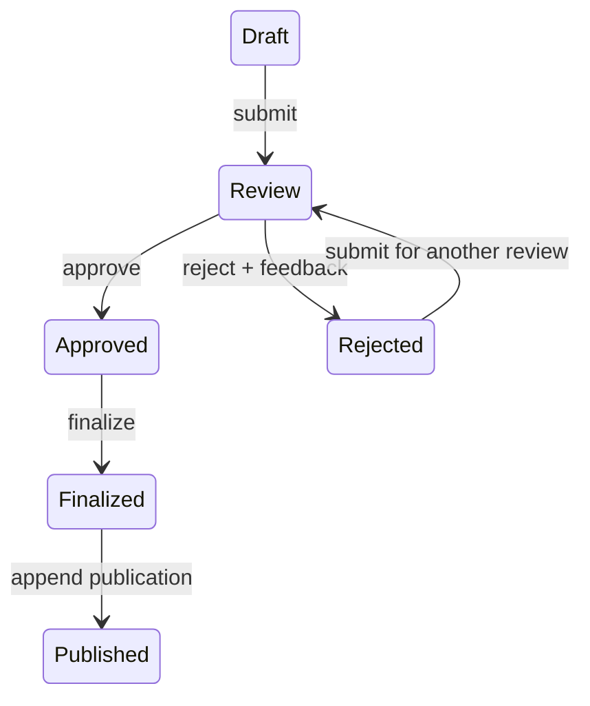

# Official Contribution V2 — Backend API contract

Status: **implemented; deployment requires approval of the new additive migration and Backend rollout**. This document describes source behavior, not endpoints currently deployed on the protected E2E runtime. Backend only; no Frontend files were read or changed.

## Version, authentication and permissions

Base route: `/api/projects/{projectId}/contribution/v2`.

JWT bearer authentication, active Student account, effective project membership required. IDs are UUIDs; dates are ISO8601 DateTimeOffset; JSON names are camelCase. Official DTOs carry `contractVersion: "1"`; reused peer DTOs retain their existing shape and numeric enum contract. Route `v2` selects the official workflow, not a new scoring formula.

Current established Contribution leader policy is **Project Creator**. A member's textual `Leader` role or a delegated Git Manager grant alone does not authorize official management. This preserves the current experimental leader policy; no new ownership-transfer/leadership permission is invented.

| Resource/action | Creator | Active frozen participant | Other active project member | Nonmember |
|---|---|---|---|---|
| Workflow status | Yes | Yes | Yes | No |
| Capture, Git metadata/readiness/membership | Yes, current repository authorization applies | No | No | No |
| Open/close cohort, peer snapshot summary | Yes | No | No | No |
| Cohort progress | Full permitted ratings/history | Progress + own outgoing rating only | No unless Creator | No |
| Submit evaluation | Only own outgoing pair if on roster | Only own outgoing pair | No | No |
| Run create/list/detail/scored/excluded/audit | Yes | No | No | No |
| Submit/review/finalize/publish | Yes | No | No | No |
| Published `results/me` | Own result if frozen participant | Own result | No | No |

No route exposes arbitrary EvidenceVersion by ID/hash, raw provider payload, frozen facts body or another member's peer comments to ordinary members. Retention after unlink/AccessLost does not grant private-facts access. Official run creation/finalization/publication must have unrestricted authorized selected evidence. Published own-result summaries do not reveal raw evidence or individual ratings. In a two-person cohort, inference anonymity is not guaranteed by aggregated percentages.

## Workflow selection

`ProjectContributionWorkflows` persists one selection per project:

- `OfficialV2`: new projects inserted after migration enablement; PostgreSQL creates the row atomically with Project insertion.
- `LegacyV1`: projects already holding a finalized legacy Contribution Cycle at migration time.
- `RequiresOptIn`: other historical projects. They are not silently moved to V2; their legacy endpoints/results remain intact.

No date-based routing or E2E project ID is used. No public opt-in/adopt-existing-experimental-run endpoint is provided. A historical opt-in requires an explicit approved policy/deployment action. Existing experimental Runs #1–#4 cannot become official/public simply by knowing their IDs.

## Routes

Successful commands currently return **200**, consistent with existing Contribution APIs. Snapshot and peer-close responses contain the actual persisted IDs. Never synthesize a UUID to recover a lost response.

| Method | Relative route | Request/response |
|---|---|---|
| GET | `/workflow` | `OfficialWorkflowResponse` |
| POST | `/snapshots` | `OfficialSnapshotRequest` → `{contractVersion,snapshotId}` |
| GET | `/snapshots/{snapshotId}` | `OfficialSnapshotResponse`, metadata/counts only |
| GET | `/snapshots/{snapshotId}/memberships` | page of `OfficialSnapshotMember`; optional category |
| GET | `/snapshots/{snapshotId}/readiness` | `OfficialReadinessResponse`, Git summary without writing a Run |
| POST | `/peer-cohorts` | `ExperimentalPeerOpenRequest` → cohort progress |
| GET | `/peer-cohorts/{cohortId}` | cohort progress, permission-filtered ratings/history |
| PUT | `/peer-cohorts/{cohortId}/evaluations/{evaluateeId}` | `ExperimentalPeerSubmitRequest` → cohort progress |
| POST | `/peer-cohorts/{cohortId}/close` | no body → `{contractVersion,peerSnapshotId}` |
| GET | `/peer-snapshots/{snapshotId}` | `OfficialPeerSnapshotResponse`, Creator-only validated score summary |
| POST | `/runs` | `OfficialRunRequest` → `OfficialRunResponse` |
| GET | `/runs` | page of `OfficialRunListItem`; optional state |
| GET | `/runs/{runId}` | `OfficialRunResponse`, Creator-only |
| POST | `/runs/{runId}/submit` | `OfficialTransitionRequest` |
| POST | `/runs/{runId}/approve` | `OfficialTransitionRequest` |
| POST | `/runs/{runId}/reject` | `OfficialTransitionRequest`; nonblank feedback required |
| POST | `/runs/{runId}/finalize` | `OfficialTransitionRequest` |
| POST | `/runs/{runId}/publish` | `OfficialTransitionRequest` |
| GET | `/runs/{runId}/activities` | page of actually scored activity references; optional category |
| GET | `/runs/{runId}/exclusions` | page of exclusion reasons; optional category |
| GET | `/runs/{runId}/audit` | page of immutable lifecycle audit events |
| GET | `/results/me` | own published `OfficialMemberResultResponse` |

### Workflow/readiness

`OfficialWorkflowResponse` fields:
`contractVersion, projectId, mode, canManage, projectCompleted, blockers[], publishedRunId, latestGitSnapshotId, latestPeerCohortId, peerState, peerSubmittedCount, peerRequiredCount, latestPeerSnapshotId, latestRunId`.

Latest references let a client resume an existing workflow after reload instead of opening a new cohort/capturing again. Git snapshot/run references are Creator-only; peer references/progress require Creator or membership in that frozen cohort. They are null for an unavailable/not-enabled workflow and do not adopt historical experimental inputs automatically. `peerState` here is a string; the reused cohort DTO's `status` remains the numeric enum below.

Workflow blockers: `HistoricalWorkflowSelectionRequired`, `ProjectNotCompleted`, `AuthorizedRepositoryRequired`, `VerifiedGitIdentityRequired`. This is an initial setup summary; empty blockers alone do **not** prove Git/Peer calculation readiness.

Capture body:

```json
{"observationCutoff":"2026-12-01T10:00:00Z"}
```

Requires a completed OfficialV2 project and a non-future cutoff. Capture uses the existing Repeatable Read service, persists exact membership/real completed retrieval receipts, finalizes atomically and performs no network fetch. It does not rerun a cutoff filter on future reads. It does not promote old policy1 or Incomplete evidence.

`OfficialSnapshotResponse`:
`contractVersion, snapshotId, projectId, createdAt, observationCutoff, policyVersion, restrictedCount, entryCount, versionCount, coverageReceiptCount`.

Membership item:
`associationId, repositoryId, observationId, jobId, versionId, category, scopeKey, contentHash, validationStatus, reason`.

Only authorized visible entries are returned. With restricted associations, count/page totals are visible-only; header `restrictedCount` signals incompleteness. No facts body is included.

`OfficialReadinessResponse`:
`contractVersion, snapshotId, gitState, inputHash, categories[], limitations[], members[], externalGitShare`.

Member summary:
`userId, provisionalRawGitScore, gitScore, gitShare`.

`gitScore`/`gitShare` and `externalGitShare` are null when not Ready. A provisional raw number is not a final share. Diagnostic roster uses the project's latest frozen cohort, or effective membership when none exists; it does not create a cohort or freeze a Contribution Run. Creating a Run always uses its explicit closed Peer Snapshot and freezes that roster/history independently.

Category item (shared DTO fields):
`category, status, eligibleActivityCount, externalActivityCount, excludedActivityCount, limitations[]`.

Official API maps the engine's `EligibleForExperimentalMvp` category status to `Complete`; other statuses/reason codes remain unchanged. Typical category values are `Commit, PR, Review, Issue`. Verified empty Review is `NotApplicable` only with matching policy2 frozen enumeration/review-scope receipts. Missing/partial/unsupported facts cannot become zero-ready evidence.

## Peer contracts

Open a completed project's full effective roster, **including Creator**:

```json
{"participantIds":["11111111-1111-4111-8111-111111111111","22222222-2222-4222-8222-222222222222"]}
```

Official open/run creation rejects a subset that omits an effective member. Frozen participant/account/membership eligibility is checked; current active status is rechecked before finalization. A subsequent membership change is not an invitation to edit an immutable roster or old calculation.

Evaluation body:

```json
{"score":4,"comment":null,"expectedRevision":null}
```

Score is an evaluator-selected integer1–5. No self-review. Comment null or ≤2000 characters. Evaluator comes from authenticated account, never from body. `expectedRevision:null` for first submission; on intentional edit use the current outgoing revision. Existing submissions are never silently overwritten by an unversioned request.

Cohort response fields:
`id, projectId, status, participantIds[], submittedCount, requiredCount, snapshotId, ratings[], history[]`.

Numeric peer status enum: **0 Open, 1 Collecting, 2 ReadyToClose, 3 Closed**. Required count is `n×(n−1)`; a one-person roster has no ratings and is immediately ReadyToClose. No automatic closure. Close validates all-to-all input and active roster, freezes Peer Snapshot and is idempotent for that same closed cohort.

Rating item:
`evaluatorId, evaluateeId, score, comment, revision, updatedAt`.

History item (Creator-only):
`evaluatorId, evaluateeId, revision, previousScore, score, previousComment, comment, changedAt`.

Peer snapshot summary:
`contractVersion, snapshotId, cohortId, policyVersion, inputHash, createdAt, participantCount, state, scores{userId:score}`.

Its canonical InputHash and score conversion are independently verified. `state` is Ready, NotApplicable for the legitimate single-person case, or InsufficientData for applicable zero mass. The existing conversion is `(mean received rating−1)/4×100`. No fake Peer ratings, zero replacement or redistribution of an applicable zero-mass component.

## Run creation and frozen calculation

```json
{
  "requestId":"33333333-3333-4333-8333-333333333333",
  "gitSnapshotId":"44444444-4444-4444-8444-444444444444",
  "peerSnapshotId":"55555555-5555-4555-8555-555555555555"
}
```

These example UUIDs are illustrative, not resources or E2E defaults.

`requestId` is a caller-generated idempotency key within the project, not a RunId. Both frozen Snapshot IDs are mandatory/nonempty. Creation requires policy2, correct project/repository/observation/job identities, completed selected retrieval jobs, supported/integrity-valid facts, verified historical attribution, closed complete Peer Snapshot/full roster, Ready positive applicable Git/Peer mass and no finalized legacy/official result conflict. No implicit capture or GitHub fetch occurs.

Run fields:
`contractVersion, id, projectId, requestId, state, revision, resultHash, calculation, finalizedAt, publishedAt`.

`calculation` reuses the existing calculation DTO, including:

- `runId, projectId, gitEvidenceSnapshotId, runNumber, scoringPolicyVersion, inputHash, status, calculatedAt, finalizedAt`.
- `categories[], results[], excludedActivities[], reviewHistory[]`.
- `peerSnapshotId, normalizationPolicyVersion, calculationStatus, externalContributionPercent`.

The shared calculator/version identifiers remain `ExperimentalGitScoringV2` and `GitPeerSeparate60_40V1` for byte/math compatibility. **This does not make the official lifecycle experimental**; workflow selection and official lifecycle registration identify official results. A second calculator/policy formula was not created.

The underlying calculation's legacy numeric `status` remains Draft0 and its legacy review fields remain empty: calculation content is frozen as soon as the official registration is inserted. **Use outer `state`, `revision`, `finalizedAt`, `publishedAt` and `/audit` for official lifecycle.** Do not route official approval through old experimental review/finalize endpoints; those reject with `OFFICIAL_LIFECYCLE_REQUIRED`. The legacy roster guard is unchanged.

Calculation result item fields:
`userId, fullName, commitScore, pullRequestScore, reviewScore, issueScore, gitScore, peerScore, totalScore, rawTotalScore, contributionPercent`.

`totalScore`/`rawTotalScore` retain old raw60/40 semantics and **must not** be displayed as normalized allocation. Only Ready `contributionPercent` is the final normalized percentage. Published member projection intentionally exposes less information.

Rules remain Commit35/PR30/Review20/Issue15; separate GitShare and PeerShare; final60/40; External only Git mass, never redistributed; deterministic largest remainder to10000 basis points. Empty Git category weight is not redistributed. Top-level verified NotApplicable may transfer weight; Incomplete/InsufficientData cannot. General partial patch allocation and historical/post-merge force-push limits remain explicit: actual unsupported overlap/ties block Ready, not guessed points. Empty Git activity is not automatically proven NotApplicable.

## Review → finalize → publication

State graph:



All state command bodies:

```json
{"expectedRevision":1,"feedback":"Verified frozen inputs and readiness."}
```

Creation revision0; each non-publication transition increments revision exactly once and appends an audit row. Rejection requires nonblank feedback ≤2000 chars; optional feedback on other transitions also has the2000 limit. Rejected results are private and may be resubmitted unchanged for another review. Revised evidence requires a new immutable snapshot/calculation, not editing percentages.

Finalize revalidates current Creator/account/member/repository permissions under locks, frozen roster against the V2 Peer Snapshot, supported facts and complete jobs, exact membership/coverage, canonical input/result hashes, deterministic shared scoring/normalization and100.00% allocation. It requires Approved and forbids conflicting finalized official/legacy results. It never compares V2 roster to legacy Cycle participants.

Finalized official header is immutable. Publication is a separate append-only row with `PublishedAt` and `PublishedById`; it does not UPDATE/unlock finalized results. GET projects outer `Published` when this record exists. Actor/time are also available via the Published audit event. Only one official finalization/publication per project. No unpublish, overwrite or public evidence endpoint.

`OfficialAuditResponse`:
`revision, action, actorId, at, feedback`.

Actions: Created, Review, Approved, Rejected, Finalized, Published. Publication uses the next audit revision without modifying the finalized header revision. Repeated same finalize/publish is idempotent; no duplicate audit event. It does not publish a different result or bypass authorization.

## Published member result

`GET /results/me` returns only the authenticated frozen participant's own published result:

```json
{
  "contractVersion":"1",
  "projectId":"11111111-1111-4111-8111-111111111111",
  "runId":"22222222-2222-4222-8222-222222222222",
  "publishedAt":"2026-12-02T10:00:00Z",
  "userId":"33333333-3333-4333-8333-333333333333",
  "gitShare":50.0,
  "peerShare":50.0,
  "contributionPercent":50.0,
  "normalizationPolicyVersion":"GitPeerSeparate60_40V1",
  "inputHash":"<64 lowercase hex characters>",
  "resultHash":"<64 lowercase hex characters>"
}
```

This is a field-shape example, not a requested calculation. Shares are unrounded component summaries; ContributionPercent is the basis-point allocated value. Before publication:404. Draft/rejected detail is Creator-only. Nonparticipants/new members cannot see others' results merely by being current project members. Departed/inactive members follow existing effective-membership access rules; audit retention does not override them.

## Paging, filtering and idempotency

All page DTOs: `contractVersion, page, pageSize, total, items[]`. Defaults page1/pageSize20; bounds page1..100000, pageSize1..100. Stable ordering is applied before slicing. No cursor or page number participates in provenance identity or scoring identity.

- Runs: `state` exact `Draft|Review|Approved|Rejected|Finalized|Published`; order createdAt descending, id.
- Memberships: optional exact retrieval category (`commits`, `pull-requests`, etc.); visible observationId order.
- Activities: optional exact scored category `Commit|PullRequest|Review|Issue`; category/object identity order. Fields `category, repositoryId, objectId, userId, activityAt, observationId, versionId, versionHash`; no facts/body. Commits represented under merged PRs and other frozen excluded inputs are not mislabeled scored.
- Exclusions: optional exact category; existing frozen deterministic order. Fields `category, repositoryId, objectId, classification, reason`.
- Audit: revision ascending.

Project row locking serializes create/review/finalize/publish, and Serializable transactions plus unique constraints protect competing writers. Stale non-idempotent transition revisions return409. SQLSTATE40001/40P01/23505 becomes safe `OFFICIAL_CONCURRENCY_CONFLICT`; retry in a new request/DbContext after reload, not inside a failed transaction.

Same project/requestId/snapshot pair returns the existing Run. Same requestId with different inputs conflicts. An already registered calculation context requested with another requestId returns `OFFICIAL_CONTEXT_EXISTS`; use its original key. Existing experimental context is not silently adopted. No automatic retry of capture/open/submission commands: capture intentionally creates a new immutable snapshot per successful call and cohort open creates a new frozen roster. If a response is lost, inspect persisted state before any deliberate retry. Peer revisions and close retain existing safe semantics.

## Errors

Existing global convention: `{ "code": "MACHINE_CODE", "message": "Safe explanation" }`;400 input/feedback/page validation,401 invalid JWT,403 unauthorized account/project/Creator,404 missing scoped object/unpublished result,409 state/integrity/readiness/concurrency conflict,503 missing official schema.

Malformed JSON/missing required body fields may instead use ASP.NET Core's existing400 ValidationProblemDetails shape (`title`, `status`, `errors`), consistent with current `[ApiController]` behavior. Business-rule errors use the code/message shape above.

Official codes:

| Code | Meaning |
|---|---|
| `OFFICIAL_SCHEMA_REQUIRED` | Deploy schema before official workflow; no auto-migration |
| `OFFICIAL_WORKFLOW_NOT_ENABLED` | Historical project not enabled; no implicit opt-in |
| `OFFICIAL_REQUEST_INVALID`, `OFFICIAL_CUTOFF_INVALID`, `OFFICIAL_PAGE_INVALID`, `OFFICIAL_STATE_INVALID` | Invalid request/filter/cutoff |
| `OFFICIAL_PROJECT_NOT_COMPLETED` | Completion prerequisite |
| `OFFICIAL_POLICY2_REQUIRED` | Policy1 is not upgraded implicitly |
| `OFFICIAL_ROSTER_MISMATCH` | Full eligible Creator-inclusive roster mismatch |
| `OFFICIAL_CALCULATION_NOT_READY`, `OFFICIAL_RETRIEVAL_INCOMPLETE` | Missing/unsupported/partial evidence or non-ready mass |
| `OFFICIAL_EVIDENCE_RESTRICTED`, `OFFICIAL_EVIDENCE_CHANGED` | Current authorization/membership/coverage verification failed |
| `OFFICIAL_INPUT_INTEGRITY`, `OFFICIAL_RESULT_INTEGRITY`, `OFFICIAL_PEER_INTEGRITY` | Canonical frozen input or deterministic output validation failed |
| `OFFICIAL_IDEMPOTENCY_CONFLICT`, `OFFICIAL_CONTEXT_EXISTS` | Key/context mismatch |
| `OFFICIAL_REVISION_CONFLICT`, `OFFICIAL_CONCURRENCY_CONFLICT` | Reload and retry a fresh unit of work |
| `OFFICIAL_TRANSITION_INVALID`, `OFFICIAL_FEEDBACK_REQUIRED`, `OFFICIAL_FEEDBACK_INVALID` | Approval graph/feedback validation |
| `OFFICIAL_NOT_FINALIZED`, `OFFICIAL_ALREADY_FINALIZED`, `OFFICIAL_PUBLICATION_CONFLICT` | Finalization/publication order or conflict |
| `OFFICIAL_LEGACY_RESULT_CONFLICT` | Finalized V1 history exists; preserve it |
| `OFFICIAL_RUN_NOT_FOUND`, `OFFICIAL_NOT_PUBLISHED` | Scoped resource not available |
| `OFFICIAL_LIFECYCLE_REQUIRED` | Old experimental mutation endpoint cannot mutate an official calculation |
| `CONTRIBUTION_USE_OFFICIAL_V2` | V1 endpoint directed at a new official project |

Inherited peer/reader/experimental errors remain safe and retain their contracts, including `PEER_REVISION_CONFLICT`, `PEER_CONCURRENCY_CONFLICT`, `PEER_SELF_REVIEW_FORBIDDEN`, `PEER_COHORT_CLOSED`, `PEER_ROSTER_INVALID`, `PEER_SNAPSHOT_NOT_FOUND`, `CONTRIBUTION_PEER_EVALUATIONS_INCOMPLETE`, `SNAPSHOT_NOT_FOUND`, `EXPERIMENTAL_RUN_NOT_OFFICIAL`. Do not treat any409 as permission to discard immutable inputs or fabricate scores.

## Deployment and compatibility

Requires additive `20261119190820_AddOfficialContributionV2Workflow` after existing evidence/authorization/coverage prerequisites. Reviewed [single-migration SQL](../migrations/OfficialContributionV2.review.sql) is a review artifact, **not permission to execute on E2E**. Do not apply the seven unrelated pending migrations.

Migration creates four new tables, supporting keys/indexes/checks/FKs and PostgreSQL guards. Only new workflow-selection rows are backfilled; old Projects, Cycles, Participants, ratings, results, Git Runs and snapshots are untouched. New Project insertion gets default selection via a DB trigger. Deleting a legitimately deletable pending project may cascade its otherwise unused workflow selection; a separate guard prevents direct selection edits/deletion, while run/source FKs and immutability prevent audit deletion. New official completion no longer constructs a legacy Cycle.

Do **not** use mixed old/new API writers during enablement: old code does not understand OfficialV2 selection/approval guards. Quiesce project/Contribution writes, back up/verify, apply only approved schema SQL, deploy tested Backend coherently, verify, then enable new writes. No migration-on-startup. New API fails safely on missing schema; unrelated V1 read paths can still operate against old schema. Rollback must retain official audit; migration Down refuses once official projects/results exist. A fresh/empty deployment rollback was tested; do not run Down against real audit data.

Experimental endpoints and DTOs remain for history. Legacy finalized results are not superseded; historical unfinalized projects retain their workflows pending an explicit policy. No official adoption route is provided for the existing E2E Run#4. Publication/finalization of that Run was not performed by this implementation task.
