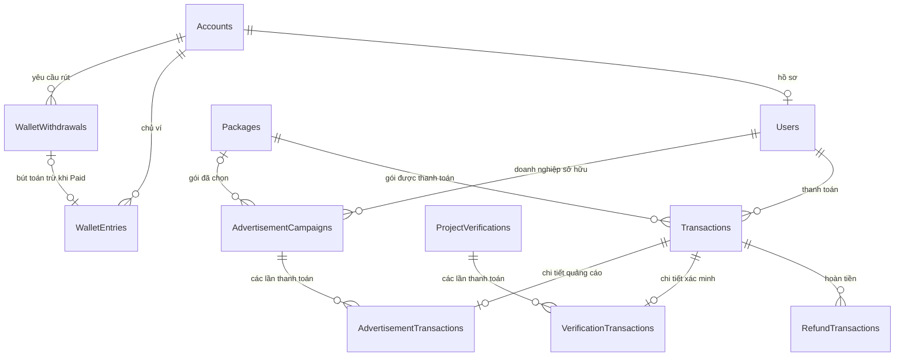
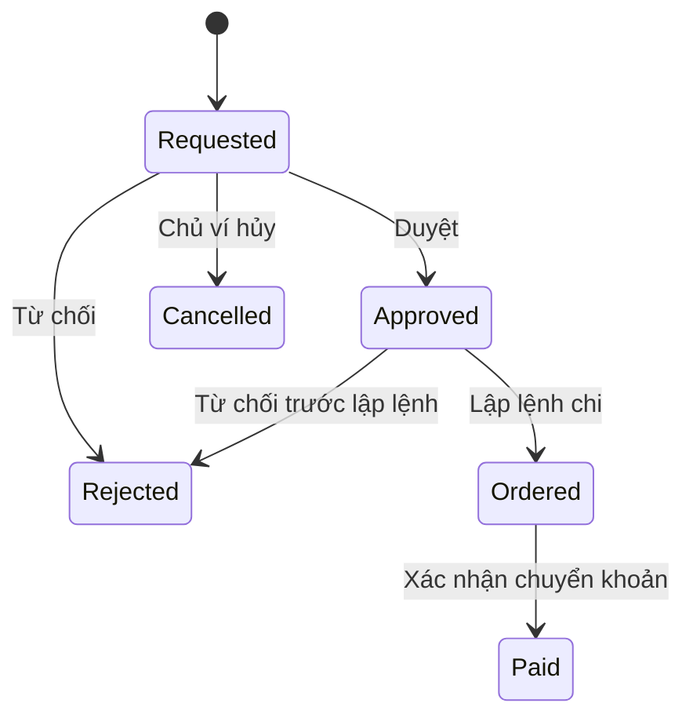

# Mô hình dữ liệu ví, thanh toán và hoàn tiền

Ngày đối chiếu mã nguồn: **06/11/2026**.

Tài liệu mô tả entity, cấu hình EF Core, migration và service trong repository. Chưa kiểm tra lịch sử migration hoặc dữ liệu của database đang triển khai. Tên bảng bên dưới theo cấu hình hiện tại, trừ phần `CompanyPackages` được ghi rõ là cấu trúc còn trong migration.

## 1. Tổng quan

| Bảng | Chức năng | Nguồn dữ liệu chính |
|---|---|---|
| `WalletEntries` | Sổ biến động thu nhập của ví | Mỗi lần cộng thu nhập hoặc xác nhận chi rút tiền |
| `WalletWithdrawals` | Yêu cầu rút tiền và quá trình xử lý | Số tiền, ngân hàng nhận, người duyệt, bằng chứng chi |
| `Transactions` | Thanh toán gói dịch vụ | Người thanh toán, gói, số tiền, trạng thái cổng thanh toán |
| `RefundTransactions` | Yêu cầu và kết quả hoàn một phần/toàn bộ tiền thanh toán | Giao dịch gốc, số tiền hoàn, duyệt, đối soát, xác nhận chi |
| `Packages` | Danh mục gói dịch vụ | Giá, loại gói, đối tượng, thời hạn |
| `VerificationTransactions` | Gắn thanh toán với hồ sơ xác minh dự án | Giao dịch, hồ sơ, mã giữ chỗ |
| `AdvertisementTransactions` | Gắn thanh toán với chiến dịch quảng cáo | Giao dịch, chiến dịch |
| `AdvertisementCampaigns` | Quản lý quảng cáo có sử dụng gói trả phí | Gói, ngân sách, trạng thái, thời gian chạy |
| `CompanyPackages` | Cấu trúc sở hữu gói của doanh nghiệp trong migration | Có entity/migration; chưa được DbContext và service hiện tại sử dụng |

Các bảng tham chiếu quan trọng:

- `Accounts`: tài khoản đăng nhập; chủ ví và nhân sự thực hiện nghiệp vụ tài chính.
- `Users`: hồ sơ người dùng, entity `UserProfile`; người thanh toán và người yêu cầu hoàn tiền.
- `ProjectVerifications`: hồ sơ xác minh dự án gắn với thanh toán qua `VerificationTransactions`.

**Phân biệt ID:** `WalletEntries.AccountId` và `WalletWithdrawals.AccountId` trỏ đến `Accounts.Id`; `Transactions.UserId`, `RefundTransactions.RequestedByUserId`, `CompanyUserId` trỏ đến hồ sơ `Users.Id`. Không dùng thay thế hai loại ID này.

## 2. Quan hệ giữa các bảng đang được sử dụng



Sơ đồ lược bỏ các liên kết đến nhân sự duyệt/xác nhận để dễ đọc. Một yêu cầu rút chỉ có bút toán trừ khi xác nhận đã chi; không tạo bút toán trừ ngay lúc gửi yêu cầu. Chưa thấy liên kết tự động giữa hoàn tiền thanh toán và cộng ví thu nhập trong `FinanceService`.

## 3. `WalletEntries` — Sổ biến động tiền trong ví

### Chức năng

Lưu các khoản tăng/giảm để tính số dư. Hiện service chỉ cho phép **tài khoản Assessor đang hoạt động** sử dụng ví cá nhân và nhận khoản cộng thu nhập qua chức năng tài chính.

| Trường | Kiểu C# | Ý nghĩa |
|---|---|---|
| `Id` | `Guid` | Khóa chính; mặc định tạo GUID mới |
| `AccountId` | `Guid` | Tài khoản sở hữu ví, FK đến `Accounts` |
| `Amount` | `decimal` | Dương: cộng thu nhập; âm: chi rút tiền |
| `SourceReference` | `string`, tối đa 150 | Mã nguồn phát sinh để chống ghi trùng |
| `Reason` | `string`, tối đa 2000 | Nội dung/lý do biến động |
| `ActorAccountId` | `Guid` | Nhân sự thực hiện ghi nhận, FK đến `Accounts` |
| `WithdrawalId` | `Guid?` | FK đến yêu cầu rút nếu đây là bút toán trừ |
| `CreatedAt` | `DateTimeOffset` | Thời điểm tạo, mặc định UTC hiện tại |

### Ràng buộc và xử lý

- `Amount` lưu dạng `numeric(18,0)`, không có phần thập phân.
- Check constraint yêu cầu: khoản dương có `WithdrawalId = null`; khoản âm có `WithdrawalId != null`; không chấp nhận số 0.
- Unique `(AccountId, SourceReference)` chống ghi một nguồn thu hai lần trên cùng ví.
- Unique `WithdrawalId` chống tạo nhiều bút toán trừ cho cùng một yêu cầu rút.
- Cộng thu nhập yêu cầu số VND nguyên dương; mã nguồn được trim và chuyển chữ hoa.
- Gửi lại mã nguồn cũ với cùng số tiền/lý do trả về bản ghi cũ; khác nội dung báo `IDEMPOTENCY_CONFLICT`.
- Tiền tố `WITHDRAWAL:` được dành riêng, không cho dùng làm mã nguồn cộng thu nhập. Bút toán chi do service tạo dùng `withdrawal:{id}`.
- Các FK cấu hình `Restrict`, tránh xóa bản ghi đang được lịch sử tài chính tham chiếu.

### Cách tính số dư

```text
Balance   = tổng WalletEntries.Amount của tài khoản
Reserved  = tổng WalletWithdrawals.Amount có State Requested / Approved / Ordered
Available = Balance - Reserved
```

Ví dụ:

| Thời điểm | Balance | Reserved | Available |
|---|---:|---:|---:|
| Được cộng thu nhập 1.000.000đ | 1.000.000 | 0 | 1.000.000 |
| Gửi yêu cầu rút 300.000đ | 1.000.000 | 300.000 | 700.000 |
| Yêu cầu được duyệt/lập lệnh chi | 1.000.000 | 300.000 | 700.000 |
| Xác nhận đã chi, tạo bút toán -300.000đ | 700.000 | 0 | 700.000 |

Nếu yêu cầu bị từ chối hoặc được hủy hợp lệ, phần giữ chỗ được giải phóng; không cần tạo bút toán hoàn lại vì trước đó chưa trừ sổ.

## 4. `WalletWithdrawals` — Yêu cầu rút tiền

### Các trường

| Trường | Kiểu C# | Ý nghĩa |
|---|---|---|
| `Id` | `Guid` | Khóa chính |
| `AccountId` | `Guid` | Chủ ví, FK đến `Accounts` |
| `RequestKey` | `Guid` | Khóa chống tạo yêu cầu trùng |
| `Amount` | `decimal` | Số tiền rút, lưu `numeric(18,0)` |
| `BankName` | `string` | Ngân hàng nhận |
| `BankAccountNumber` | `string` | Số tài khoản nhận |
| `BankAccountHolder` | `string` | Tên chủ tài khoản nhận |
| `State` | `WithdrawalState` | Trạng thái nghiệp vụ |
| `CreatedAt` | `DateTimeOffset` | Thời điểm gửi |
| `ReviewedBy`, `ReviewedAt` | `Guid?`, `DateTimeOffset?` | Nhân sự và thời điểm duyệt |
| `ReviewReason` | `string?` | Lý do duyệt |
| `RejectedBy`, `RejectedAt` | `Guid?`, `DateTimeOffset?` | Nhân sự và thời điểm từ chối |
| `RejectionReason` | `string?` | Lý do từ chối |
| `OrderedBy`, `OrderedAt` | `Guid?`, `DateTimeOffset?` | Người lập lệnh chi và thời điểm |
| `ConfirmedBy`, `ConfirmedAt` | `Guid?`, `DateTimeOffset?` | Người xác nhận đã chi và thời điểm |
| `PayingAccount` | `string?` | Tài khoản phía chi tiền, dùng làm bằng chứng đối soát |
| `BankReference` | `string?` | Mã giao dịch ngân hàng đã chi |
| `Version` | `Guid` | Concurrency token; đổi sau mỗi thao tác cập nhật qua service |

Các trường ngân hàng và bằng chứng chi tối đa 150 ký tự; lý do duyệt/từ chối tối đa 2000 ký tự. Các trường người thực hiện là FK đến `Accounts`.

### Trạng thái và chuyển đổi

| Giá trị | Trạng thái | Ý nghĩa |
|---:|---|---|
| 0 | `Requested` | Mới gửi, đang giữ số tiền yêu cầu |
| 1 | `Approved` | Đã duyệt, vẫn giữ tiền |
| 2 | `Ordered` | Đã lập lệnh chi, vẫn giữ tiền |
| 3 | `Paid` | Xác nhận đã chi, đã ghi bút toán âm |
| 4 | `Rejected` | Bị từ chối, không giữ tiền nữa |
| 5 | `Cancelled` | Chủ ví hủy yêu cầu, không giữ tiền nữa |



### Quy tắc chính

- Chủ ví phải là Assessor đang hoạt động; số tiền phải là số nguyên dương và không vượt `Available`.
- `RequestKey` không được là GUID rỗng; unique `(AccountId, RequestKey)`.
- Gửi lại cùng khóa và cùng số tiền/ngân hàng/người nhận trả về bản ghi cũ; thay đổi dữ liệu báo xung đột.
- Thông tin chủ ví, khóa yêu cầu, số tiền, ngân hàng và ngày tạo được EF chặn sửa sau khi lưu.
- Chủ ví chỉ được hủy ở `Requested`; gọi hủy lại một yêu cầu đã `Cancelled` được chấp nhận.
- Lập lệnh chi yêu cầu `Approved`; xác nhận chi yêu cầu `Ordered`.
- Xác nhận chi ghi trạng thái `Paid` và thêm bút toán âm trong cùng transaction.
- `(PayingAccount, BankReference)` unique trong bảng. Service còn kiểm tra trùng với bằng chứng chuyển khoản hoàn tiền trong `RefundTransactions`.
- `PayingAccount` và `BankReference` được trim/chuyển chữ hoa trước xác nhận. Gửi lại xác nhận `Paid` với đúng bằng chứng cũ không tạo khoản trừ mới.
- Transaction dùng mức cô lập Serializable; PostgreSQL có advisory lock theo chủ ví và xử lý xung đột đồng thời.

Các trường ngân hàng là bản chụp theo từng yêu cầu rút, không phải danh bạ tài khoản ngân hàng dùng chung.

## 5. `Transactions` — Giao dịch thanh toán

Lưu việc người dùng thanh toán gói dịch vụ. Không dùng bảng này để tính số dư ví thu nhập.

| Trường | Kiểu C# | Ý nghĩa |
|---|---|---|
| `Id` | `Guid` | Khóa chính |
| `UserId` | `Guid` | FK đến hồ sơ `Users`, không phải `Accounts` |
| `PackageId` | `Guid` | FK đến `Packages` |
| `Status` | `PaymentStatus` | Pending / Success / Failed |
| `Amount` | `decimal` | Số tiền của giao dịch, `numeric(18,2)`, không âm |
| `PaymentRef` | `string?`, 255 | Mã tham chiếu thanh toán |
| `PaymentUrl` | `string?`, 2048 | Đường dẫn thanh toán |
| `PaymentQrCode` | `string?`, 4096 | Dữ liệu QR thanh toán |
| `PaymentMethod` | `string?`, 100 | Phương thức/nhà cung cấp, ví dụ `PayOS` |
| `ProviderOrderCode` | `string?`, 255 | Mã đơn bên nhà cung cấp |
| `ProviderPaymentLinkId` | `string?`, 255 | Mã liên kết thanh toán bên nhà cung cấp |
| `PaidAt` | `DateTimeOffset?` | Thời điểm thanh toán, nếu luồng xử lý có ghi nhận |
| `ExpiredAt` | `DateTimeOffset?` | Thời điểm hết hạn thanh toán |
| `FailureReason` | `string?`, text | Nguyên nhân thất bại |
| `CreatedAt`, `UpdatedAt` | `DateTimeOffset` | Thời điểm tạo/cập nhật |

`PaymentStatus`: `Pending = 0`, `Success = 1`, `Failed = 2`.

Quan hệ: một giao dịch có tối đa một chi tiết xác minh và tối đa một chi tiết quảng cáo theo từng quan hệ 1–1; có thể có nhiều lần hoàn tiền. Cấu hình quan hệ không tự cấm một giao dịch đồng thời có cả hai loại chi tiết; nghiệp vụ cần tạo đúng loại.

Index phục vụ truy vấn theo `(UserId, Status)`, `(Status, ExpiredAt)` và mã nhà cung cấp. Với `PaymentMethod = 'PayOS'`, các mã `ProviderOrderCode` và `ProviderPaymentLinkId` không null được áp dụng unique theo phương thức.

## 6. `RefundTransactions` — Yêu cầu/giao dịch hoàn tiền

### Chức năng

Theo dõi hoàn tiền từ một thanh toán gốc, gồm duyệt nội bộ, thực thi/đối soát với nhà cung cấp hoặc xác nhận chuyển khoản thủ công. Một thanh toán có thể được hoàn nhiều lần trong phạm vi số tiền còn được phép hoàn.

| Trường | Kiểu C# | Ý nghĩa |
|---|---|---|
| `Id` | `Guid` | Khóa chính |
| `TransactionId` | `Guid` | FK đến thanh toán gốc `Transactions` |
| `Amount` | `decimal` | Số tiền hoàn, `numeric(18,2)`, constraint không âm |
| `Approval` | `RefundApproval` | Trạng thái phê duyệt nội bộ |
| `Status` | `PaymentStatus` | Trạng thái thực hiện hoàn tiền |
| `RequestKey` | `Guid?` | Khóa chống tạo trùng; unique khi có giá trị |
| `RequestedByUserId` | `Guid?` | FK đến hồ sơ `Users` của người yêu cầu |
| `RequestedAt` | `DateTimeOffset?` | Thời điểm yêu cầu |
| `RequestSource` | `RefundRequestSource` | LegacyUnknown = 0, System = 1, Admin = 2 |
| `Reason` | `string`, text | Lý do hoàn |
| `PaymentProvider` | `string`, 100 | Nhà cung cấp/phương thức của khoản hoàn |
| `RefundRef` | `string?`, 255 | Mã hoàn tiền hoặc mã chuyển khoản đã xác nhận |
| `ReviewedByAccountId` | `Guid?` | FK đến `Accounts` của người duyệt |
| `ReviewedAt` | `DateTimeOffset?` | Thời điểm duyệt |
| `ReviewReason` | `string?`, 2000 | Lý do duyệt/từ chối |
| `ManualPayingAccount` | `string?`, 150 | Tài khoản phía chi hoàn tiền |
| `ManualBankReference` | `string?`, 150 | Mã chuyển khoản hoàn tiền thủ công |
| `ConfirmedByAccountId` | `Guid?` | FK đến `Accounts` của người xác nhận đã chi |
| `FailureReason` | `string?`, text | Lỗi xử lý hoặc dấu hiệu cần xử lý thủ công |
| `DispatchStartedAt` | `DateTimeOffset?` | Thời điểm bắt đầu gửi yêu cầu đến provider |
| `NextReconciliationAt` | `DateTimeOffset?` | Lịch đối soát tiếp theo |
| `ReconciliationAttempts` | `int` | Số lần xử lý/đối soát đã ghi nhận |
| `CompletedAt` | `DateTimeOffset` | Thời điểm hoàn thành; hiện khai báo không nullable |
| `CreatedAt`, `UpdatedAt` | `DateTimeOffset` | Thời điểm tạo/cập nhật |

**Lưu ý `CompletedAt`:** không dùng riêng trường này để kết luận đã hoàn tiền. Luôn kiểm tra `Status == Success`; bản ghi đang chờ có thể mang giá trị mặc định của kiểu ngày.

### Hai trạng thái độc lập

| `Approval` | Giá trị | Ý nghĩa |
|---|---:|---|
| `NotRequired` | 0 | Không yêu cầu duyệt nội bộ trong luồng tương ứng |
| `Pending` | 1 | Chờ duyệt |
| `Approved` | 2 | Được duyệt; chưa có nghĩa đã trả tiền |
| `Rejected` | 3 | Bị từ chối |

`Status` dùng chung enum thanh toán: `Pending = 0`, `Success = 1`, `Failed = 2`. Duyệt thành công chỉ đổi `Approval`; xác nhận chi/nhà cung cấp xác nhận mới đổi `Status` sang `Success`.

### Quy tắc tạo và duyệt trong chức năng tài chính

1. Thanh toán gốc phải `Success`; số tiền yêu cầu là số VND nguyên dương.
2. Số tiền không được vượt phần thanh toán chưa bị các khoản hoàn khác chiếm dụng.
3. Tạo từ `FinanceService` ghi `Approval = Pending`, `Status = Pending`, nguồn `Admin` và hồ sơ người tạo.
4. Người tạo không được tự duyệt yêu cầu hoàn của mình; service yêu cầu một nhân sự khác có quyền.
5. Chỉ duyệt khi còn `Approval = Pending`, `Status = Pending` và chưa dispatch. Từ chối đồng thời ghi `Status = Failed`.
6. Thông tin người yêu cầu, thời điểm yêu cầu và nguồn được EF chặn thay đổi sau lưu.

`RequestKey` bắt buộc ở API tạo hoàn của finance dù cột database nullable để tương thích các luồng cũ/hệ thống. Dùng lại khóa với khác người tạo/giao dịch/số tiền/lý do báo `IDEMPOTENCY_CONFLICT`.

### Phần tiền đang được giữ cho hoàn tiền

`RefundReservations.Reserved` cộng các khoản thỏa cả hai điều kiện:

- `Approval != Rejected`.
- `Status != Failed`, **hoặc** lý do thuộc `AssignmentTimeout` / `ReplacementTimeout` của `VerificationDeadlineTasks`.

```text
Số tiền có thể tạo yêu cầu hoàn tiếp
    = Transactions.Amount - RefundReservations.Reserved(các khoản hoàn của giao dịch)
```

Do đó khoản đã hoàn thành vẫn chiếm phần tiền đã hoàn; không được hoàn thêm chính phần đó. Hai lý do timeout đặc biệt vẫn giữ phần tiền tương ứng khi thất bại để tránh tạo yêu cầu hoàn bù trùng.

### Hoàn tiền thủ công và worker

- Xác nhận thủ công yêu cầu `Approval` là `Approved` hoặc `NotRequired`, `Status = Pending`, chưa dispatch và thanh toán gốc đã `Success`.
- Nhân sự cần thực hiện chuyển khoản thực tế bên ngoài trước, rồi nhập `PayingAccount` và `BankReference` để xác nhận. API xác nhận không tự chuyển khoản ngân hàng.
- Service lưu bằng chứng, người xác nhận, `RefundRef`, `CompletedAt`, đổi sang `Success` và xóa lỗi/lịch đối soát.
- Bằng chứng `(ManualPayingAccount, ManualBankReference)` unique trong bảng; service kiểm tra trùng cả với `WalletWithdrawals`.
- Worker `VerificationRefundTasks` xử lý các khoản hoàn xác minh đủ điều kiện. Sau dispatch, lần sau dùng lookup để đối soát cùng yêu cầu, tránh gửi yêu cầu hoàn thứ hai.
- Adapter `ManualRefundProvider` hiện không hỗ trợ gửi/tra cứu hoàn tự động. Worker ghi `MANUAL_REFUND_REQUIRED` và hẹn kiểm tra lại; không giả lập hoàn thành công.

**Chưa có:** ngân hàng nhận, số tài khoản nhận và tên chủ tài khoản nhận hoàn tiền. `ManualPayingAccount` là phía chi, không phải người nhận. Không có liên kết FK trực tiếp từ khoản hoàn sang `WalletEntries`.

## 7. `Packages` — Danh mục gói dịch vụ

| Trường | Kiểu C# | Ý nghĩa |
|---|---|---|
| `Id` | `Guid` | Khóa chính |
| `Code` | `string`, 100 | Mã gói, unique |
| `Name` | `string`, 255 | Tên gói |
| `Type` | `PackageType` | Verification = 0; Advertisement = 1 |
| `Role` | `TargetRole` | Student = 0; Company = 1 |
| `Price` | `decimal` | Giá `numeric(18,2)`, không âm |
| `DurationInDays` | `int?` | Thời hạn theo ngày; nếu có phải lớn hơn 0 |
| `IsActive` | `bool` | Gói còn được cung cấp hay không |
| `CreatedAt`, `UpdatedAt` | `DateTimeOffset` | Thời điểm tạo/cập nhật |

Index `(Type, Role, IsActive)` phục vụ lọc danh mục. `Transactions.Amount` lưu số tiền riêng của giao dịch; không nên dùng giá gói hiện tại để suy ngược số tiền đã thanh toán trong lịch sử.

## 8. `VerificationTransactions` — Chi tiết thanh toán xác minh

| Trường | Kiểu C# | Ý nghĩa |
|---|---|---|
| `TransactionId` | `Guid` | Vừa là PK vừa là FK đến `Transactions` |
| `VerificationId` | `Guid` | FK đến `ProjectVerifications` |
| `ReservationId` | `Guid?` | Mã giữ chỗ tại thời điểm tạo checkout |
| `CreatedAt`, `UpdatedAt` | `DateTimeOffset` | Thời điểm tạo/cập nhật |

Một hồ sơ có thể có nhiều giao dịch; mỗi giao dịch chỉ có một chi tiết xác minh. `ReservationId` giữ lại token của lượt giữ chỗ mà checkout được tạo cho, phục vụ phân biệt các lần đặt/thanh toán. Không thấy cấu hình FK cho `ReservationId` tại mapping này.

Xóa giao dịch sẽ cascade chi tiết; xóa hồ sơ đang được tham chiếu bị `Restrict`. Có index `VerificationId`. Bảng không lưu thêm số tiền để tránh phải đồng bộ với `Transactions`.

## 9. `AdvertisementTransactions` — Chi tiết thanh toán quảng cáo

| Trường | Kiểu C# | Ý nghĩa |
|---|---|---|
| `Id` | `Guid` | Khóa chính |
| `TransactionId` | `Guid` | FK unique đến `Transactions` theo quan hệ 1–1 |
| `CampaignId` | `Guid` | FK đến `AdvertisementCampaigns` |
| `CreatedAt`, `UpdatedAt` | `DateTimeOffset` | Thời điểm tạo/cập nhật |

Một chiến dịch có thể có nhiều lần thanh toán, mỗi giao dịch gắn tối đa một chi tiết quảng cáo. Mapping hiện tại cascade chi tiết khi xóa giao dịch hoặc chiến dịch; đây là khác biệt với quan hệ hoàn tiền dùng `Restrict`.

Trong `AdvertisementService`, checkout tạo một `Transaction` có số tiền từ `BudgetCap` và một chi tiết quảng cáo. Xác nhận thanh toán thành công đổi giao dịch sang `Success`, chiến dịch sang `Active`, ghi thời gian bắt đầu/hết hạn nếu gói có thời hạn. Thất bại đổi giao dịch sang `Failed`; chiến dịch vẫn có thể chờ thanh toán lại.

## 10. `AdvertisementCampaigns` — Chiến dịch quảng cáo

| Trường | Kiểu C# | Ý nghĩa |
|---|---|---|
| `Id` | `Guid` | Khóa chính |
| `CompanyUserId` | `Guid` | FK đến hồ sơ doanh nghiệp trong `Users` |
| `PackageId` | `Guid?` | FK đến gói; có thể chưa chọn ở bản nháp |
| `Title`, `Content` | `string` | Tiêu đề và nội dung quảng cáo |
| `DestinationUrl` | `string` | Đích khi bấm quảng cáo |
| `MediaUrl` | `string?` | Ảnh/nội dung media |
| `Status` | `AdCampaignStatus` | Trạng thái vận hành chiến dịch |
| `BudgetCap` | `decimal` | Giá trị ngân sách `numeric(18,2)`; service gán theo giá gói khi chọn gói |
| `RejectionReason` | `string?` | Lý do từ chối |
| `ImpressionCount`, `ClickCount` | `long` | Số lượt hiển thị và bấm |
| `StartedAt`, `ExpiredAt` | `DateTimeOffset?` | Thời gian chạy/hết hạn |
| `CreatedAt`, `UpdatedAt` | `DateTimeOffset` | Thời điểm tạo/cập nhật |

Trạng thái: Draft = 0, PendingModeration = 1, PendingPayment = 2, Active = 3, Completed = 4, Rejected = 5.

`BudgetCap` là thông tin chiến dịch, không phải số dư ví và không phải bằng chứng đã thu tiền. Muốn xác định đã thanh toán cần kiểm tra giao dịch liên quan. FK doanh nghiệp và gói sử dụng `Restrict`.

## 11. `CompanyPackages` — Cấu trúc còn trong migration

**Trạng thái đối chiếu:** entity `CompanyPackage` còn trong domain; migration `20261104064140_UpdateAdvertisementFlow` tạo bảng. Migration `20261104071249_FixAdFlowAndRejectionReason` bổ sung `CampaignId` và chuyển chiến dịch về liên kết trực tiếp `PackageId`. Trong DbContext, snapshot hiện tại và service đã kiểm tra không thấy sử dụng `CompanyPackage`.

Vì vậy, không nên hiểu đây là luồng mua/lưu gói đang hoạt động. Việc bảng có tồn tại trên một môi trường cụ thể phụ thuộc migration đã áp dụng.

| Trường | Nguồn | Ý nghĩa thiết kế |
|---|---|---|
| `Id` | Entity + migration | PK của gói thuộc doanh nghiệp |
| `CompanyUserId` | Entity + migration | FK đến `Users` |
| `PackageId` | Entity + migration | FK đến `Packages` |
| `Status` | Entity + migration | Available = 0, InUse = 1, Used = 2, Expired = 3 |
| `CreatedAt`, `UpdatedAt` | Entity + migration | Thời điểm tạo/cập nhật |
| `CampaignId` | Migration bổ sung | FK nullable đến chiến dịch; entity hiện chỉ có navigation `Campaign`, không có property scalar này |

Migration bổ sung index `CampaignId`; migration tạo bảng có index `CompanyUserId` và `PackageId`. Tài liệu này chỉ ghi nhận hiện trạng, không khẳng định việc đồng bộ schema/runtime đã hoàn tất.

## 12. Các luồng và API tài chính

### Ví và rút tiền

1. Nhân sự có quyền cộng thu nhập → tạo `WalletEntries` dương.
2. Assessor gửi yêu cầu rút → tạo `WalletWithdrawals.Requested`, giữ phần tiền tương ứng.
3. Nhân sự duyệt → `Approved`.
4. Nhân sự lập lệnh → `Ordered`.
5. Chuyển tiền thực tế bên ngoài và xác nhận → `Paid` + `WalletEntries` âm.

### Thanh toán và hoàn tiền

1. Chọn gói → tạo `Transactions.Pending` cùng chi tiết xác minh/quảng cáo.
2. Nhận kết quả xử lý thanh toán → cập nhật `Success` hoặc `Failed` theo luồng tương ứng.
3. Tạo yêu cầu hoàn từ giao dịch thành công → `RefundTransactions`, kiểm tra phần tiền còn được hoàn.
4. Duyệt nếu luồng yêu cầu → người duyệt khác người tạo trong API finance.
5. Hoàn qua provider nếu có adapter, hoặc chuyển khoản bên ngoài rồi xác nhận thủ công.
6. Ghi `RefundTransactions.Success`; giao dịch gốc vẫn được dùng làm nguồn thanh toán để đối soát, khoản hoàn theo dõi riêng.

| API | Mục đích |
|---|---|
| `GET /api/wallet` | Số dư, khóa yêu cầu mới và tối đa 100 bút toán/100 yêu cầu rút gần nhất |
| `POST /api/wallet/withdrawals` | Gửi yêu cầu rút |
| `POST /api/wallet/withdrawals/{id}/cancel` | Chủ ví hủy |
| `GET /api/admin/finance/summary` | Tổng hợp tài chính |
| `GET /api/admin/finance/recipients?search=...` | Tìm Assessor nhận cộng thu nhập |
| `GET /api/admin/finance/ledger` | Danh sách bút toán |
| `POST /api/admin/finance/wallet/credits` | Ghi cộng thu nhập |
| `GET /api/admin/finance/payments` | Danh sách thanh toán |
| `GET /api/admin/finance/withdrawals` | Danh sách yêu cầu rút |
| `POST /api/admin/finance/withdrawals/{id}/review` | Duyệt/từ chối rút |
| `POST /api/admin/finance/withdrawals/{id}/order` | Lập lệnh chi |
| `POST /api/admin/finance/withdrawals/{id}/confirm` | Xác nhận đã chuyển tiền rút |
| `GET /api/admin/finance/refunds` | Danh sách hoàn tiền |
| `POST /api/admin/finance/refunds` | Tạo yêu cầu hoàn |
| `POST /api/admin/finance/refunds/{id}/review` | Duyệt/từ chối hoàn |
| `POST /api/admin/finance/refunds/{id}/confirm` | Xác nhận đã chuyển hoàn tiền |
| `GET /api/admin/finance/report.csv` | Xuất tổng hợp tài chính |

Các danh sách quản trị ledger/payments/withdrawals/refunds dùng phân trang 30 bản ghi. API cá nhân xác thực rồi kiểm tra quyền sở hữu và vai trò hiện tại trong database. API quản trị yêu cầu role `Admin,Accountant` và quyền nghiệp vụ tương ứng tại service.

### Cách đọc báo cáo tổng hợp

| Chỉ số | Cách tính hiện tại |
|---|---|
| `PaymentsReceived` | Tổng `Transactions.Amount` có `Status = Success` |
| `RefundsPaid` | Tổng `RefundTransactions.Amount` có `Status = Success` |
| `WithdrawalsPaid` | Tổng yêu cầu rút ở `Paid` |
| `WalletIncome` | Tổng bút toán ví dương |
| `PendingWithdrawals` | Tổng yêu cầu rút ở Requested/Approved/Ordered |
| `RefundsAwaitingReview` | Số khoản hoàn có `Approval = Pending` |

Các số tổng hợp này chưa phải một sổ kế toán kép hoặc báo cáo lợi nhuận. Khoản cộng thu nhập là ghi nhận vào ví; khoản rút là chi trả phần thu nhập đó. Không cộng cả hai thành hai lần chi tiền thực tế.

## 13. Giới hạn hiện tại cần nắm

- Chưa có bảng `Wallets` lưu số dư vật lý; số dư được tính từ sổ và yêu cầu rút đang giữ tiền.
- Chưa có bảng `BankAccounts` cho người dùng lưu/chọn tài khoản ngân hàng dùng lại.
- Ngân hàng nhận rút tiền được lưu trực tiếp trong từng `WalletWithdrawals`.
- `RefundTransactions` chưa có bộ thông tin ngân hàng người nhận hoàn tiền.
- Ví thu nhập hiện phục vụ Assessor; không suy ra mọi người thanh toán đều có ví.
- Chưa có adapter hoàn tiền tự động hoạt động trong `ManualRefundProvider`; xác nhận thủ công không thay thế thao tác chuyển tiền thực tế.
- Bảng/migration `CompanyPackages` không chứng minh luồng sở hữu gói đang được sử dụng.
- Các giá tiền thanh toán/gói/hoàn có scale 2 trong schema, trong khi API finance và ví yêu cầu VND nguyên. Phải phân biệt constraint database với validation của từng service.
- Tài liệu này không thay đổi schema, dịch vụ hay dữ liệu tài chính.

## 14. Nguồn đối chiếu và bảo trì

- [WalletFinance.cs](../UniNet.Domain/Entities/WalletFinance.cs): trường dữ liệu ví, rút và enum duyệt hoàn.
- [Transaction.cs](../UniNet.Domain/Entities/Transaction.cs), [RefundTransaction.cs](../UniNet.Domain/Entities/RefundTransaction.cs): thanh toán và hoàn tiền.
- [Package.cs](../UniNet.Domain/Entities/Package.cs), [VerificationTransaction.cs](../UniNet.Domain/Entities/VerificationTransaction.cs): gói và chi tiết xác minh.
- [AdvertisementTransaction.cs](../UniNet.Domain/Entities/AdvertisementTransaction.cs), [AdvertisementCampaign.cs](../UniNet.Domain/Entities/AdvertisementCampaign.cs), [CompanyPackage.cs](../UniNet.Domain/Entities/CompanyPackage.cs): quảng cáo và entity gói doanh nghiệp.
- [UniNetDbContext.cs](../UniNet.Infrastructure/Data/UniNetDbContext.cs), [FinanceConfiguration.cs](../UniNet.Infrastructure/Data/FinanceConfiguration.cs): mapping, kiểu tiền, FK, index, check constraint.
- [FinanceService.cs](../UniNet.Application/Services/FinanceService.cs): số dư, điều kiện chủ ví, cộng thu nhập và rút tiền.
- [FinanceRefunds.cs](../UniNet.Application/Services/FinanceRefunds.cs), [RefundReservations.cs](../UniNet.Application/Services/RefundReservations.cs): hoàn tiền và phần tiền đã giữ.
- [VerificationRefundTasks.cs](../UniNet.Application/Services/VerificationRefundTasks.cs), [ManualRefundProvider.cs](../UniNet.Application/Services/ManualRefundProvider.cs): worker và giới hạn adapter hoàn tiền.
- [AdvertisementService.cs](../UniNet.Application/Services/AdvertisementService.cs): thanh toán quảng cáo.
- [FinanceController.cs](../UniNet.API/Controllers/FinanceController.cs), [NotificationPermissionPolicy.cs](../UniNet.Application/Services/NotificationPermissionPolicy.cs): API và quyền tài chính.
- [Migration tạo CompanyPackages](../UniNet.Infrastructure/Data/Migrations/20261104064140_UpdateAdvertisementFlow.cs), [migration điều chỉnh quảng cáo](../UniNet.Infrastructure/Data/Migrations/20261104071249_FixAdFlowAndRejectionReason.cs): phân biệt cấu trúc lịch sử với mapping runtime.
- [Handoff ví Assessor](handoffs/assessor-wallet.md), [handoff thanh toán xác minh](handoffs/verification-payments.md): bối cảnh triển khai và kiểm thử trước đây.

Khi thay đổi trường, enum, công thức số dư, chuyển trạng thái hoặc mapping, cập nhật phần tương ứng trong tài liệu này. Trước khi dựa vào bảng lịch sử để phát triển chức năng mới, kiểm tra model runtime và migration thực tế của môi trường đích.
